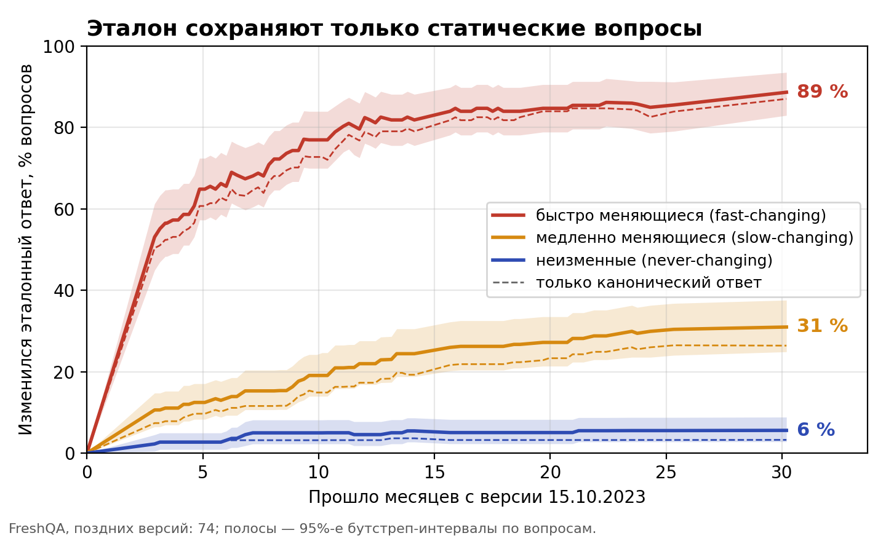

# Система оценки качества ответов больших языковых моделей по новостным текстам стран Восточной Азии

*A System for Evaluating the Quality of Large Language Model Answers on East Asian News Texts*

[](https://github.com/Priestprog/east-asia-news-llm-eval/blob/main/LICENSE)
[](https://github.com/Priestprog/east-asia-news-llm-eval/graphs/contributors)
[](https://github.com/Priestprog/east-asia-news-llm-eval/issues)
[](https://github.com/Priestprog/east-asia-news-llm-eval/pulls)

<table>
    <tr>
        <td align="left"> <b> Author </b> </td>
        <td> Багров Александр Михайлович, факультет вычислительной математики и кибернетики МГУ имени М. В. Ломоносова (<a href="https://github.com/Priestprog">Priestprog</a>) </td>
    </tr>
    <tr>
        <td align="left"> <b> Advisor </b> </td>
        <td> Воронцов Константин Вячеславович, д.ф.-м.н. </td>
    </tr>
    <tr>
        <td align="left"> <b> Consultant </b> </td>
        <td> Воронцов Константин Вячеславович, д.ф.-м.н. </td>
    </tr>
    <tr>
        <td align="left"> <b> Institution </b> </td>
        <td> Московский государственный университет имени М. В. Ломоносова, факультет вычислительной математики и кибернетики (Lomonosov Moscow State University, Faculty of Computational Mathematics and Cybernetics) </td>
    </tr>
    <tr>
        <td align="left"> <b> Defense </b> </td>
        <td> июнь 2027 </td>
    </tr>
</table>


## Аннотация / Abstract

Системы, где большая языковая модель отвечает на вопросы по статьям новостного архива, внедряются быстрее, чем появляются способы проверить их ответы. Существующие проверочные наборы англоязычны или содержат вопросы с меняющимся во времени ответом, а согласие автоматической оценки с людьми и разметчиков между собой обычно не сообщается. В работе строится система оценки ответов на вопросы о новостях Восточной Азии: вопрос задаётся по-русски, источники написаны по-китайски. Оценивается ответ, то есть текст и процитированные документы. Система оценки включает четыре части. Первая: строгая постановка задачи только для вопросов с неизменным во времени ответом, чтобы эталон не устаревал. Вторая: эталонный набор вопросов с ответами и подтверждающими документами, включая вопросы с правильным ответом «не знаю»; каждый вопрос независимо размечают три человека, их согласие измеряется. Третья: метрики правильности, точности ссылок, отказов и поиска; оценки правильности и ссылок, в том числе от другой языковой модели, допускаются к сравнению, только если согласуются с оценками людей на русскоязычных ответах. Четвёртая: попарная статистическая проверка различий систем на одних и тех же вопросах с поправкой на множественные сравнения. Исследуется промышленная система «Chinese Media Analysis» Института востоковедения РАН (архив из 23,9 млн фрагментов). Её предстоит сравнить с шестью открытыми моделями без поиска и по той же поисковой выдаче, всего 13 систем.

Systems in which a large language model answers questions about articles in a news archive are being deployed faster than ways to check their answers appear. Existing test sets are in English or contain questions whose answers change over time, and the agreement of automatic evaluation with humans and of annotators with each other is usually not reported. This thesis builds a system for evaluating answers to questions about East Asian news: the question is asked in Russian, and the sources are written in Chinese. What is evaluated is the answer, that is, the text and the cited documents. The evaluation system has four parts. First, a rigorous problem statement restricted to questions whose answers do not change over time, so that the reference does not go stale. Second, a reference set of questions with answers and supporting documents, including questions whose correct answer is "I don't know"; each question is annotated independently by three people, and their agreement is measured. Third, metrics of correctness, citation accuracy, abstention and retrieval; correctness and citation scores, including those produced by another language model, are admitted to the comparison only if they agree with human ratings on Russian-language answers. Fourth, a paired statistical test of differences between systems on the same questions with a correction for multiple comparisons. The object of study is the industrial system "Chinese Media Analysis" of the Institute of Oriental Studies of the Russian Academy of Sciences (an archive of 23.9 million chunks). It is to be compared with six open models without retrieval and over the same retrieval results, 13 systems in total.

## Общее описание задачи

Мы решаем проблему отсутствия количественной и воспроизводимой оценки качества ответов вопросно-ответных систем на основе больших языковых моделей над новостным корпусом стран Восточной Азии. Она важна, потому что такие системы уже используются востоковедами и аналитиками для работы с китайскоязычными СМИ, а единственным свидетельством их качества остаются качественные наблюдения и отдельные примеры. Известные дефекты: ложная атрибуция фактов источнику другого года, номера цитат вне списка источников, нерелевантные фрагменты с высокой косинусной близостью, непереведённые китаизмы, неоправданные отказы не измеряются, а значит, не могут быть ни отслежены при смене модели-генератора, ни сопоставлены между системами. Без системы оценки утверждение «система работает хорошо» остаётся недоказуемым.

Ключевое ограничение постановки — статические вопросы. Новостной корпус — движущаяся мишень: если ответ на вопрос меняется со временем (курс валюты, действующее должностное лицо, «текущая ситуация»), эталон устаревает через месяцы, и расхождение ответа системы с эталоном невозможно отличить от устаревания самого эталона. Ограничение предикатом $`\mathrm{Inv}(q)`$ — ответ полностью определяется зафиксированным снимком корпуса и не изменяется при $`t\ge t_0`$ — делает выборку долговечной, а расхождение — интерпретируемым как ошибка системы. Кроме того, только на статических вопросах корректно сравнение системы с поиском и модели без поиска: если открытая модель отвечает верно без доступа к корпусу, это утечка знаний из предобучения, которую можно измерить напрямую, а не списать на изменившийся мир.

Существующие бенчмарки не закрывают эту нишу. RGB (Chen et al., 2023) оценивает четыре способности моделей на новостных вопросах на китайском и английском, но не привязан к конкретному корпусу и не содержит эталонных опорных документов; CDQA (Xu et al., 2024), ближайший конкурент ChronoQA (2025; 5176 вопросов по 300 тыс. китайских новостей) и российский DRAGOn (2025; регулярно пересобираемый набор по новостям) намеренно состоят из динамических, времязависимых вопросов — противоположная постановка, а RecencyQA (2026) показывает, что стационарность ответа — размечаемое свойство вопроса. Ни один из них не оценивает промышленную систему над заданным корпусом с ответами на русском языке, не включает вопросов, правильный ответ на которые — отказ (хотя именно готовность отвечать без опоры на корпус различает системы сильнее, чем точность), и не сообщает меру согласия аннотаторов. Судья на основе языковой модели при оценке правильности относительно эталона коррелирует с людьми заметно сильнее, чем точное совпадение и F1 (Ho et al., 2025), однако его надёжность и валидность — разные свойства (Norman et al., 2026), а согласие с людьми на русском языке ниже, чем на английском (REPA, 2025), поэтому судья валидируется на русскоязычных ответах. В России публичных работ по оценке систем с дополнением поиском над китайскоязычными новостями с эталонной выборкой, несколькими аннотаторами и сравнением промышленной системы с открытыми моделями не найдено; русскоязычные ресурсы REPA, POLLUX и RusHallu-RAG покрывают оценку генерации, открытых судей и детекцию галлюцинаций, но не вопросно-ответные системы над иноязычным новостным корпусом. Полный обзор — 56 работ с вердиктами по гипотезам — в [LINKREVIEW.md](LINKREVIEW.md).

## Формальная постановка задачи

Полная версия с протоколом разметки и обсуждением решений — в [docs/problem_statement.md](docs/problem_statement.md); правила разметки — в [docs/annotation_guidelines.md](docs/annotation_guidelines.md); стандарт обозначений — [ADR-016](docs/decisions.md#adr-016-стандарт-обозначений-v2).

### Дано

1. Момент фиксации $`t_0`$ и корпус $`D=\{d_j\}_{j=1}^N`$, где $`d_j=(\iota_j,u_j,\tau_j,s_j,x_j^{zh},x_j^{ru})`$ — стабильный идентификатор документа (`webpage_id`/`urn_uuid`), URL, дата публикации $`\tau_j\le t_0`$, источник, текст оригинала и его перевод. Множество идентификаторов обозначается $`\mathcal{I}`$. Разбиение на фрагменты — деталь ретривера; единственное требование — каждый фрагмент отображается в идентификатор $`\iota_j\in\mathcal{I}`$.

2. Пространства: вопросы $`\mathcal{Q}`$ (на русском языке); ответы $`\mathcal{A}=\mathcal{A}^+\sqcup\{\bot\}`$, где $`\bot`$ — отказ («Я не знаю.»); цитирования $`2^{\mathcal{I}}`$ — подмножества идентификаторов документов.

3. Инвариантность во времени. Пусть $`a^*(q,t)`$ — истинный ответ на вопрос $`q`$ при состоянии мира в момент $`t`$. Вопрос статический, если

   $`\displaystyle \mathrm{Inv}(q)\iff\exists\,a^*(q)\in\mathcal{A}^+:\ \forall t\ge t_0\quad a^*(q,t)=a^*(q).`$

   Операционализация: (а) существует непустое $`S^*_q\subset\mathcal{I}`$, документы которого влекут ответ, $`\{x_\iota\}_{\iota\in S^*_q}\models a^*(q)`$, то есть ответ выводим из снимка $`D_{t_0}`$ и не требует знаний вне него; (б) для медленно меняющихся величин вопрос содержит явную дату-якорь. Оценка предиката по меткам $`R`$ аннотаторов: $`\widehat{\mathrm{Inv}}(q)=\mathbb{I}\left[\sum_{r=1}^R z_r(q)=R\right]`$, где $`z_r(q)\in\{0,1\}`$ — метка $`r`$-го аннотатора после применения правил исключения: $`E_1`$ — прогнозы и гипотетика; $`E_2`$ — маркеры «сейчас», «на данный момент», «последний», «текущая ситуация»; $`E_3`$ — величины без даты-якоря (цены, курсы, индексы, действующие должностные лица); $`E_4`$ — ответ зависит от момента запроса или политической оценки; $`E_5`$ — ложная предпосылка. В терминах таксономии FreshQA допускаются never-changing вопросы; slow-changing — только с датой-якорем; fast-changing и false-premise исключаются.

4. Эталонная выборка $`G=G^+\sqcup G^{\bot}`$. Здесь $`G^+=\{(q_i,A^*_i,S^*_i,\mu_i)\}_{i=1}^{n_+}`$ — вопросы с подтверждаемым ответом: $`A^*_i`$ — канонический ответ и множество алиасов/транслитераций; $`S^*_i\subset\mathcal{I}`$, $`|S^*_i|\ge1`$ — опорные документы; $`\mu_i`$ — метаданные (тип вопроса, категория, источник, дата-якорь, голоса аннотаторов, сложность, split). $`G^{\bot}`$ — вопросы, инвариантные по форме, но не подтверждаемые корпусом (правильный ответ — отказ $`\bot`$); $`n_{\bot}\approx0.1\,n`$, $`n=n_++n_{\bot}`$.

5. Класс систем $`\mathcal{H}=\{f:\mathcal{Q}\to\mathcal{A}\times2^{\mathcal{I}}\}`$, $`f(q)=(\hat a,\hat S)`$ — ответ и множество процитированных документов. Оцениваемое подмножество

   $`\displaystyle \mathcal{H}_{\mathrm{eval}}=\{f_{\mathrm{prod}}\}\cup\{f_0^{(\ell)}\}_{\ell\in\mathcal{L}}\cup\{f_\rho^{(\ell)}\}_{\ell\in\mathcal{L}},`$

   где $`f_{\mathrm{prod}}(q)=g_{\mathrm{prod}}(q,\rho_{\mathrm{prod}}(q))`$ — промышленная система (ретривер Qdrant + SearchAPI и генератор); $`f_0^{(\ell)}(q)=(g_\ell(q),\varnothing)`$ — открытая модель $`\ell`$ без поиска; $`f_\rho^{(\ell)}(q)=g_\ell(q,\rho_{\mathrm{prod}}(q))`$ — та же выдача промышленного ретривера с другой моделью-генератором (абляция «модель против ретривера»; контексты $`\rho_{\mathrm{prod}}(q)`$ кэшируются и общие для всех $`\ell`$). $`\mathcal{L}`$ — список открытых моделей провайдера ИВ РАН (раздел «Оцениваемые системы»).

6. Семейство метрик $`M=\{m_k\}`$, $`m_k:\mathcal{A}\times2^{\mathcal{I}}\times G_i\to[0,1]\cup\{\mathrm{NA}\}`$, ориентация «больше — лучше»:
   - по эталону (на $`G^+`$): $`\mathrm{EM}=\max_{a\in A^*_i}\mathbb{I}[\mathrm{norm}(\hat a)=\mathrm{norm}(a)]`$; токенный F1 после лемматизации, максимум по алиасам; BERTScore-F1 (мультиязычный энкодер); $`m_J^{\mathrm{corr}}`$ — LLM-судья «правильность относительно $`A^*_i`$», шкала 0–5, делённая на 5 (новый критерий, у существующей рубрики его нет); $`m_J^{(c)}`$, $`d\in`$ {faithfulness, answer_relevancy, completeness, citation_accuracy, temporal_correctness, allegory_idiom_quality, hallucination_abstention} — существующая рубрика как кандидатное подсемейство;
   - цитирование: $`\mathrm{CP}_{\mathrm{id}}=|\hat S\cap S^*_i|/|\hat S|`$ ($`\mathrm{NA}`$ при $`\hat S=\varnothing`$); $`\mathrm{CR}_{\mathrm{id}}=|\hat S\cap S^*_i|/|S^*_i|`$ (для систем без поиска равна 0); $`\mathrm{CP}_{\mathrm{ent}}=\frac{1}{|\hat S|}\sum_{\iota\in\hat S}\mathbb{I}[x_\iota\models\hat a]`$ через NLI или судью (по ALCE; нужна, потому что $`S^*_i`$ может быть неполным в корпусе из 23,9 млн фрагментов);
   - отказы: $`\mathrm{AR}=\frac{1}{n_{\bot}}\sum_{G^{\bot}}\mathbb{I}[\hat a = \bot]`$; $`1-\mathrm{FAR}`$, где $`\mathrm{FAR}=\frac{1}{n_+}\sum_{G^+}\mathbb{I}[\hat a = \bot]`$;
   - поиск (компонент $`\rho_{\mathrm{prod}}`$): Hit@K, Recall@K, MRR, nDCG@K относительно $`S^*_i`$.

7. Человеческие оценки $`h^{(r)}_{i,f}\in\{0,\dots,5\}`$ (правильность, обоснованность) $`r`$-го аннотатора для ответа системы $`f`$ на вопрос $`q_i`$ на подвыборке $`G_h\subset G^+`$, $`|G_h|=n_h`$ (цель $`n_h=100`$), для подмножества систем $`\mathcal{H}_h\subset\mathcal{H}_{\mathrm{eval}}`$; $`\bar h_{i,f}`$ — среднее по $`r`$.

### Найти

1. Выборку $`G`$, удовлетворяющую ограничениям (ниже).

2. Валидированное подсемейство метрик

   $`\displaystyle M'=\{m_k\in M:\ r_S(m_k,\bar h)\ge r_{\min}\ \text{на}\ G_h\times\mathcal{H}_h\}\cup M_{\mathrm{det}},\qquad r_{\min}=0.5,`$

   где $`r_S`$ — коэффициент ранговой корреляции Спирмена с 95%-м бутстреп-интервалом; потолок для сравнения — среднее попарное согласие людей между собой. $`M_{\mathrm{det}}`$ — детерминированные метрики без человеческого аналога ($`\mathrm{AR}`$, $`1-\mathrm{FAR}`$, $`\mathrm{CR}_{\mathrm{id}}`$, метрики поиска), включаемые напрямую.

3. Для каждой $`f\in\mathcal{H}_{\mathrm{eval}}`$ и $`m_k\in M'`$ — средние по вопросам

   $`\displaystyle \bar m_k(f)=\frac{1}{|I_k(f)|}\sum_{i\in I_k(f)}m_k\big(f(q_i);G_i\big),\qquad I_k(f)=\{i:\ m_k(f(q_i);G_i)\ne\mathrm{NA}\};`$

   композитный показатель $`Q(f)=\sum_{m_k\in M'_Q} w_k\,\bar m_k(f)`$ по подмножеству $`M'_Q\subset M'`$ метрик, определённых на ответах (метрики поиска характеризуют общий компонент $`\rho_{\mathrm{prod}}`$ и публикуются отдельно), $`w_k\ge0`$, $`\sum_k w_k=1`$ (по умолчанию веса равные); лучшую систему

   $`\displaystyle f^\star=\arg\max_{f\in\mathcal{H}_{\mathrm{eval}}}Q(f)=\arg\min_{f\in\mathcal{H}_{\mathrm{eval}}}\sum_{m_k\in M'_Q}w_k\bigl(1-\bar m_k(f)\bigr)`$

   — минимум взвешенной доли ошибок — с проверкой статистической значимости парных различий.

### Критерий качества и статистика

Первичная метрика фиксируется до эксперимента: $`m_J^{\mathrm{corr}}`$, если она пройдёт валидацию по $`H_4`$, иначе токенный F1; остальные метрики — вторичные. Для пары систем $`(f,f')`$ вычисляются поточечные разности $`\delta_i=m_k(f(q_i))-m_k(f'(q_i))`$ на общих вопросах $`i\in I_k(f)\cap I_k(f')`$; применяется парный бутстреп по вопросам ($`B=10^4`$, перцентильный 95%-й интервал для $`\bar\delta`$); двусторонний критерий Уилкоксона знаковых рангов (нулевые разности делятся между знаками; для бинарных метрик — точный критерий Мак-Немара) с поправкой Холма на уровне значимости $`0.05`$ в четырёх семьях: {первичная метрика, $`Q(f)`$} × {12 сравнений $`f'\ne f_{\mathrm{prod}}`$ для $`H_1`$, $`H_2`$; 6 пар $`(f_\rho^{(\ell)},f_0^{(\ell)})`$ для $`H_3`$}; размер эффекта — $`\Delta_{\mathrm{C}}`$ Клиффа. Гипотезы $`H_1`$–$`H_3`$ принимаются при $`p_{\mathrm{Holm}}<0.05`$ и $`\bar\delta>0`$ ([ADR-018](docs/decisions.md#adr-018-двусторонний-критерий-уилкоксона-и-четыре-семьи-поправки-холма)). Буква $`\alpha`$ везде обозначает только коэффициент согласия Криппендорфа; уровень значимости записывается числом. Разбивка по стратам (категория, источник, тип вопроса, известность события) приводится описательно, без проверки гипотез. Генерация — temperature 0 и фиксированный seed; для судьи — temperature 0 и отчёт о его собственной воспроизводимости (повторные прогоны на подвыборке).

### Ограничения

- Снимок корпуса $`D_{t_0}`$ зафиксирован: дата, $`N`$, хеш списка $`\mathcal{I}`$. Для каждого $`i`$ выполнено $`S^*_i\subset\mathcal{I}`$, и документы $`S^*_i`$ присутствуют в Qdrant, поэтому покрытие корпуса равно 1 по построению.
- Размер: $`n\ge150`$ (цель 200–300); не менее 3 доменов и 2 регионов; охват по датам публикации не менее 12 месяцев; разбиение dev (30 вопросов) / test.
- Судья $`\ell_J\notin\mathcal{L}\cup\{\ell_{\mathrm{prod}}\}`$, либо используется ансамбль двух судей; отдельная проверка самопредпочтения ($`H_5`$).
- Провайдер ИВ РАН (llama-swap): fail-fast при неизвестном идентификаторе модели; для каждого ответа записывается фактическое поле `model` из ответа API и снимок `/v1/models` на момент прогона.
- Публикуются идентификаторы документов, URL, даты и короткие evidence-span, но не полные тексты статей.
- Время: защита в июне 2027. Сентябрь–октябрь 2026 — постановка, инструкция разметки, пилот на 30 вопросах, обзор литературы; ноябрь–декабрь 2026 — разметка 250 вопросов и заморозка `v1.0`; январь 2027 — прогоны; февраль 2027 — валидация и статистика; март–апрель 2027 — текст и слайды.

### Протокол разметки (кратко)

Стратифицированный отбор документов из `webmedia.webpages ∩ Qdrant` (домен × месяц × категория) с переизбытком ×2; черновики $`(q,a,S,\mathrm{evidence},\text{тип},\text{дата})`$ порождает генератор $`g_{\mathrm{draft}}`$ на модели $`\ell_{\mathrm{draft}}\notin\mathcal{L}`$ (388 старых вопросов — seed pool после перекладки `warc_id → webpage_id`); независимая разметка $`R=3`$ аннотаторами (не менее одного, читающего по-китайски); согласие — $`\alpha`$ Криппендорфа по инвариантности, отвечаемости и типу ($`\alpha\ge0.67`$ допустимо, $`\alpha\ge0.8`$ надёжно) и попарный F1 по ответам $`\ge0.8`$; включение в $`G`$ при единогласии, иначе адъюдикация четвёртым экспертом; пилот на 30 вопросах → правка инструкции → полный прогон → заморозка `v1.0` (sha256, CHANGELOG). Правила $`E_1`$–$`E_5`$, шкалы и примеры — в [docs/annotation_guidelines.md](docs/annotation_guidelines.md).

### Гипотезы

- $`H_1`$ (основная): $`Q(f_{\mathrm{prod}})>Q(f_0^{(\ell)})`$ для всех $`\ell\in\mathcal{L}`$ — промышленная система с поиском превосходит любую открытую модель без поиска.
- $`H_2`$ (сильная): $`Q(f_{\mathrm{prod}})>Q(f_\rho^{(\ell)})`$ для всех $`\ell\in\mathcal{L}`$ — при опровержении вклад ретривера и модели-генератора разделяется явно.
- $`H_3`$: $`Q(f_\rho^{(\ell)})>Q(f_0^{(\ell)})`$ для всех $`\ell\in\mathcal{L}`$ — поиск по корпусу повышает качество ответов каждой модели.
- $`H_4`$: $`r_S(m_J^{\mathrm{corr}},\bar h)\ge0.5`$ и $`\alpha_h\ge0.67`$ — судья валиден, а человеческая разметка согласована.
- $`H_5`$: самопредпочтение судьи статистически незначимо.


## Эталонная выборка

Эталонная выборка $`G=G^+\sqcup G^{\bot}`$ — главный артефакт данных работы; её описание, схема и история версий лежат в [data/golden_set/README.md](data/golden_set/README.md), [data/golden_set/schema.json](data/golden_set/schema.json) и `data/golden_set/CHANGELOG.md`.

- **Состав.** $`G^+`$ — статические вопросы на русском языке с каноническим ответом, алиасами и не менее одним опорным документом из корпуса; $`G^{\bot}`$ — вопросы той же формы, ответ на которые корпусом не подтверждается (правильный ответ — отказ), $`n_{\bot}\approx0.1\,n`$. Требования: не менее 3 доменов, 2 регионов, охват по датам публикации не менее 12 месяцев; стратификация домен × месяц × категория; разбиение dev (30) / test.
- **Размер.** $`n\ge150`$, цель 200–300 вопросов; человеческая валидация метрик — на подвыборке $`G_h`$, $`n_h=100`$.
- **Версии.** `v0.1-pilot` — 30 вопросов (октябрь 2026) для проверки инструкции разметки и оценки согласия; `v1.0` — заморозка в декабре 2026 с sha256 всех файлов в `CHANGELOG.md`. После заморозки изменения вносятся только новыми версиями; каждая строка результатов указывает версию выборки.
- **Формат.** JSONL, одна запись на вопрос. Поля: `id`, `version`, `split`, `question{ru,zh,en}`, `question_type`, `category`, `answerable`, `answer{canonical, aliases, type, lang}`, `supporting_docs[{webpage_id, urn_uuid, uri, published_at, source, evidence_span_ru, evidence_span_zh}]`, `requires_multi_doc`, `time_invariance{label, anchor_date, votes, exclusion_rules_checked}`, `difficulty`, `provenance{draft_model, draft_prompt_id, seed_pool_ref, annotators, adjudicated, created_at}`.
- **Лицензия.** Разметка (вопросы, ответы, алиасы, метаданные, evidence-span) распространяется по лицензии CC BY 4.0.
- **Что не публикуется.** Полные тексты статей и их переводы: они остаются в корпусе ИВ РАН. В выборке — только стабильные идентификаторы `webpage_id`/`urn_uuid`, URL, даты публикации и короткие evidence-span.
- **Происхождение.** Черновики порождает генератор $`g_{\mathrm{draft}}`$ на модели $`\ell_{\mathrm{draft}}\notin\mathcal{L}`$; 388 вопросов из промышленного репозитория используются как seed pool (`data/seed_pool/`) после перекладки ключей `warc_id → webpage_id`; они не являются эталоном, поскольку не содержат ответов и признака статичности.

## Оцениваемые системы

Описание конфигураций, промптов и режимов — в [docs/systems.md](docs/systems.md) и `code/configs/systems/`.

| Обозначение | Ретривер | Генератор | Число систем |
|---|---|---|---|
| $`f_{\mathrm{prod}}`$ | $`\rho_{\mathrm{prod}}`$: Qdrant (23,9 млн фрагментов, `distiluse-base-multilingual-cased-v2`) + SearchAPI | $`g_{\mathrm{prod}}`$ — генератор промышленной системы (провайдер ИВ РАН, фактическая модель фиксируется по полю `model`) | 1 |
| $`f_\rho^{(\ell)}`$ | $`\rho_{\mathrm{prod}}`$, выдача кэшируется и общая для всех $`\ell`$ | $`g_\ell`$, $`\ell\in\mathcal{L}`$ | 6 |
| $`f_0^{(\ell)}`$ | без поиска ($`\hat S=\varnothing`$) | $`g_\ell`$, $`\ell\in\mathcal{L}`$ | 6 |

Список открытых моделей $`\mathcal{L}`$ (провайдер ИВ РАН, OpenAI-совместимый API через llama-swap; замер доступности 2026-09-04):

1. DeepSeek-R1-Distill-Qwen-32B
2. Qwen3.6-27B
3. Qwen3.8-27B
4. GigaChat-20B-A3B
5. GLM-4.1V-9B-Thinking
6. Qwen-AgentWorld-35B-A3B

Исключены как специализированные: Hy-MT2-30B-A3B (машинный перевод), Laguna-XS-2.1, Qwen3-Coder-30B-A3B. Итого $`|\mathcal{H}_{\mathrm{eval}}|=13`$.

Оговорка о провайдере: llama-swap при неизвестном идентификаторе модели может тихо подставить другую модель (так модель по умолчанию промышленной системы `Qwen/Qwen3.5-9B`, отсутствующая у провайдера, фактически заменяется на DeepSeek-R1-Distill-Qwen-32B). Поэтому клиент работает в режиме fail-fast: идентификатор проверяется по `/v1/models` до прогона, для каждого ответа сохраняется фактическое поле `model`, а снимок `/v1/models` записывается в `results/runs/<run_id>/`.

## Метрики

Определения, нормализация текста, обработка $`\mathrm{NA}`$ и промпты судьи — в [docs/metrics.md](docs/metrics.md). Все метрики принимают значения в $`[0,1]\cup\{\mathrm{NA}\}`$, ориентация «больше — лучше».

| Группа | Метрика | Определение | Область | Статус |
|---|---|---|---|---|
| По эталону | EM | $`\max_{a\in A^*_i}\mathbb{I}[\mathrm{norm}(\hat a)=\mathrm{norm}(a)]`$ | $`G^+`$ | новая |
| По эталону | F1 | токенный F1 после лемматизации, максимум по алиасам $`a\in A^*_i`$ | $`G^+`$ | новая |
| По эталону | BERTScore-F1 | мультиязычный энкодер, максимум по алиасам | $`G^+`$ | новая |
| По эталону | $`m_J^{\mathrm{corr}}`$ | LLM-судья: правильность $`\hat a`$ относительно $`A^*_i`$, шкала 0–5, делённая на 5 | $`G^+`$ | новая, кандидат на первичную |
| По эталону | $`m_J^{(c)}`$ | рубрика судьи по семи критериям $`c`$ (faithfulness, answer_relevancy, completeness, citation_accuracy, temporal_correctness, allegory_idiom_quality, hallucination_abstention), 0–5, делённая на 5 | $`G^+`$ | существующий прототип, подлежит валидации |
| Цитирование | $`\mathrm{CP}_{\mathrm{id}}`$ | $`\lvert\hat S\cap S^*_i\rvert/\lvert\hat S\rvert`$; $`\mathrm{NA}`$ при $`\hat S=\varnothing`$ | $`G^+`$ | новая |
| Цитирование | $`\mathrm{CR}_{\mathrm{id}}`$ | $`\lvert\hat S\cap S^*_i\rvert/\lvert S^*_i\rvert`$; для систем без поиска 0 | $`G^+`$ | новая |
| Цитирование | $`\mathrm{CP}_{\mathrm{ent}}`$ | $`\frac{1}{\lvert\hat S\rvert}\sum_{\iota\in\hat S}\mathbb{I}[x_\iota\models\hat a]`$ через NLI или судью | $`G^+`$ | новая |
| Отказы | $`\mathrm{AR}`$ | $`\frac{1}{n_{\bot}}\sum_{G^{\bot}}\mathbb{I}[\hat a = \bot]`$ — доля верных отказов | $`G^{\bot}`$ | новая |
| Отказы | $`1-\mathrm{FAR}`$ | $`\mathrm{FAR}=\frac{1}{n_+}\sum_{G^+}\mathbb{I}[\hat a = \bot]`$ — доля ложных отказов | $`G^+`$ | новая |
| Поиск | Hit@K, Recall@K, MRR | относительно $`S^*_i`$, по выдаче $`\rho_{\mathrm{prod}}`$ | $`G^+`$, только $`f_{\mathrm{prod}}`$ и $`f_\rho^{(\ell)}`$ | существующие, переносятся |
| Поиск | nDCG@K | относительно $`S^*_i`$, бинарная релевантность | $`G^+`$, только $`f_{\mathrm{prod}}`$ и $`f_\rho^{(\ell)}`$ | новая |

Метрики по эталону и цитированию проходят валидацию по $`H_4`$ и входят в $`M'`$ только при $`r_S(m_k,\bar h)\ge0.5`$; метрики отказов, $`\mathrm{CR}_{\mathrm{id}}`$ и метрики поиска детерминированы, образуют $`M_{\mathrm{det}}`$ и включаются в $`M'`$ напрямую.

## Главная таблица результатов

Заполняется по итогам прогонов (январь–февраль 2027). Столбцы — метрики $`M'`$ (окончательный состав фиксируется после валидации), формат ячейки — `mean [lo; hi]` (парный бутстреп, 95 %); звёздочка при $`p_{\mathrm{Holm}}<0.05`$ в сравнении с $`f_{\mathrm{prod}}`$; последние столбцы — $`Q(f)`$ и ранг. Версия выборки: `v1.0`.

| Система | Генератор | Режим | $`m_J^{\mathrm{corr}}`$ | F1 | BERTScore | $`\mathrm{CP}_{\mathrm{id}}`$ | $`\mathrm{CR}_{\mathrm{id}}`$ | $`\mathrm{AR}`$ | $`1-\mathrm{FAR}`$ | Recall@K | $`Q(f)`$ | Ранг |
|---|---|---|---|---|---|---|---|---|---|---|---|---|
| $`f_{\mathrm{prod}}`$ | $`g_{\mathrm{prod}}`$ | Qdrant + SearchAPI | — | — | — | — | — | — | — | — | — | — |
| $`f_\rho^{(\ell)}`$ | DeepSeek-R1-Distill-Qwen-32B | $`\rho_{\mathrm{prod}}`$ | — | — | — | — | — | — | — | — | — | — |
| $`f_\rho^{(\ell)}`$ | Qwen3.6-27B | $`\rho_{\mathrm{prod}}`$ | — | — | — | — | — | — | — | — | — | — |
| $`f_\rho^{(\ell)}`$ | Qwen3.8-27B | $`\rho_{\mathrm{prod}}`$ | — | — | — | — | — | — | — | — | — | — |
| $`f_\rho^{(\ell)}`$ | GigaChat-20B-A3B | $`\rho_{\mathrm{prod}}`$ | — | — | — | — | — | — | — | — | — | — |
| $`f_\rho^{(\ell)}`$ | GLM-4.1V-9B-Thinking | $`\rho_{\mathrm{prod}}`$ | — | — | — | — | — | — | — | — | — | — |
| $`f_\rho^{(\ell)}`$ | Qwen-AgentWorld-35B-A3B | $`\rho_{\mathrm{prod}}`$ | — | — | — | — | — | — | — | — | — | — |
| $`f_0^{(\ell)}`$ | DeepSeek-R1-Distill-Qwen-32B | без поиска | — | — | — | — | 0 | — | — | $`\mathrm{NA}`$ | — | — |
| $`f_0^{(\ell)}`$ | Qwen3.6-27B | без поиска | — | — | — | — | 0 | — | — | $`\mathrm{NA}`$ | — | — |
| $`f_0^{(\ell)}`$ | Qwen3.8-27B | без поиска | — | — | — | — | 0 | — | — | $`\mathrm{NA}`$ | — | — |
| $`f_0^{(\ell)}`$ | GigaChat-20B-A3B | без поиска | — | — | — | — | 0 | — | — | $`\mathrm{NA}`$ | — | — |
| $`f_0^{(\ell)}`$ | GLM-4.1V-9B-Thinking | без поиска | — | — | — | — | 0 | — | — | $`\mathrm{NA}`$ | — | — |
| $`f_0^{(\ell)}`$ | Qwen-AgentWorld-35B-A3B | без поиска | — | — | — | — | 0 | — | — | $`\mathrm{NA}`$ | — | — |

Широкая таблица выше строится целью `make tables` из длинной таблицы `results/tables/main_table_long.csv` (одна строка — одна пара «система × метрика») со столбцами:

```
system_id, model_id_reported, quantization, retriever, top_k, prompt_version, temperature,
n_samples, metric, n, mean, ci_low, ci_high, delta_vs_prod, p_wilcoxon, p_holm,
run_id, git_sha, date
```

Здесь `model_id_reported` — фактическое поле `model` из ответов провайдера, `n` — число вопросов с $`m_k\ne\mathrm{NA}`$, `delta_vs_prod` — $`\bar\delta`$ относительно $`f_{\mathrm{prod}}`$, `git_sha` — коммит кода, которым получен прогон.


## Базовый эксперимент: почему существующие наборы не подходят

Эталон времязависимого вопроса устаревает, и тогда расхождение ответа системы с эталоном нельзя считать ошибкой системы. Чтобы проверить эту посылку на данных, проведён аудит существующих наборов вопросов (ADR-020).



- **FreshQA**, 75 версий за 30 месяцев: изменились эталоны 89 % быстро меняющихся вопросов (95%-й интервал [83; 94]), 31 % медленно меняющихся ([25; 38]) и 5,6 % неизменных ([2,8; 8,8]).
- **CDQA**: 78 % вопросов времязависимы по разметке самих авторов; **ChronoQA** времязависим по замыслу; **DRAGOn** пересобирается, и ни один вопрос версии 1.15.0 не встречается в версии 1.0.0.
- **388 вопросов промышленной системы**: эталонных ответов нет, а половина формулировок отмечена эвристиками правил $`E_1`$, $`E_2`$, $`E_4`$ (прогноз, момент запроса, оценка).

Вывод: для долговечной оценки нужен собственный эталон из статических вопросов, статичность которых подтверждают несколько аннотаторов. Сводная таблица по девяти наборам — [results/audit/datasets_summary.md](results/audit/datasets_summary.md).

Запуск: `make audit` или `python -m code.audit`. Данные скачиваются в `data/external/` (не входит в git), таблицы пишутся в `results/audit/`, рисунки — в `results/figures/`; версии данных и seed бутстрепа зафиксированы, повторный запуск даёт те же числа.

## Материалы (Assets)

- [LinkReview](LINKREVIEW.md) — обзор литературы: 56 работ (от основ оценки поиска и согласия аннотаторов XX века до работ 2025–2026 годов) по пяти блокам — оценка систем с дополнением поиском; судья на основе языковой модели; временная динамика, выборки и согласие; китайско- и русскоязычные ресурсы и метрики; статистика сравнения систем — с вердиктом по гипотезам $`H_1`$–$`H_5`$ и положениям постановки для каждой работы
- [Code](code) — код разметки, систем, метрик и статистики; конфиги в `code/configs/`
- [Data](data/golden_set) — эталонная выборка (схема, версии, история изменений); [seed pool](data/seed_pool/provenance.md) — 388 вопросов промышленной системы, исходный пул черновиков
- [Paper](paper/main.pdf) — текст работы; собирается из [paper/main.tex](paper/main.tex)
- [Slides](slides/main.pdf) — презентация к защите; собирается из [slides/main.tex](slides/main.tex)
- [One slide](slides/one_slide.pdf) — работа на одном слайде ([PNG](slides/one_slide.png)); собирается из [slides/one_slide.tex](slides/one_slide.tex)
- [Docs](docs) — постановка задачи, инструкция разметки, метрики, системы, журнал решений


## Цитирование

```bibtex
@thesis{bagrov2027evalsystem,
  type       = {Bachelor's thesis},
  author     = {Bagrov, Alexander},
  title      = {Система оценки качества ответов больших языковых моделей по новостным текстам стран Восточной Азии},
  titleaddon = {A System for Evaluating the Quality of Large Language Model Answers on East Asian News Texts},
  school     = {Lomonosov Moscow State University, Faculty of Computational Mathematics and Cybernetics},
  address    = {Moscow},
  year       = {2027},
  url        = {https://github.com/Priestprog/east-asia-news-llm-eval},
  note       = {In Russian. English title: A System for Evaluating the Quality of Large Language Model Answers on East Asian News Texts}
}

@misc{bagrov2027goldenset,
  author       = {Bagrov, Alexander},
  title        = {East Asian News Static QA Golden Set},
  year         = {2027},
  howpublished = {\url{https://github.com/Priestprog/east-asia-news-llm-eval/tree/main/data/golden_set}},
  note         = {Version 1.0. Annotation licensed under CC BY 4.0}
}
```

## Лицензия

- Код — MIT, см. [LICENSE](LICENSE).
- Разметка эталонной выборки (вопросы, ответы, алиасы, метаданные, evidence-span в `data/golden_set/`) — [CC BY 4.0](https://creativecommons.org/licenses/by/4.0/).
- Тексты новостных статей и их переводы не распространяются: в выборке публикуются только идентификаторы, URL, даты и короткие evidence-span; полные тексты остаются в корпусе ИВ РАН.
